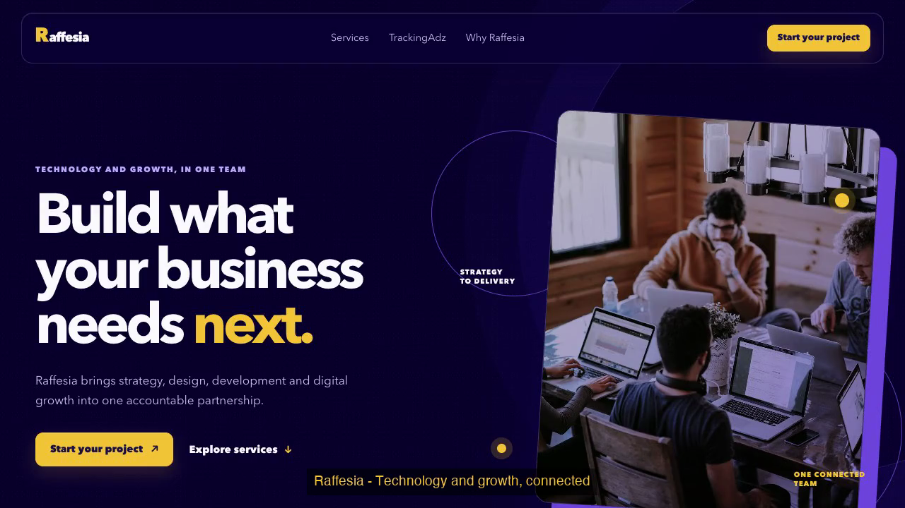

# Raffesia — Single-Page Website Prototype


A hand-built, single-page responsive website for **Raffesia Technologies** — showing the company's positioning, services, TrackingAdz product concept, and an enquiry path, in a dark-violet (`#09002e`) + gold (`#f3c63a`) design system.

**Built during the internship showcase period at Raffesia Technologies (mentor: Mr. Gaurav Gangwar, Co-Founder & MD) — presenter-builder: Deepak Gangwar, B.Tech IT, SRMS CET Bareilly.**

---

## 🔒 Confidentiality note (please read first)

This repository is a **showcase prototype only**. The **full production platform of the company is protected and remains confidential to Raffesia Technologies** — production deployments, customer data, business systems and internal tooling are *not* included here and are never published. The official live company website at [raffesia.com](https://raffesia.com) is **separate** from this prototype. What you see here is exactly what we are able to share publicly.

## 🌐 Live links at a glance (presentation panel — read this first)

| What | Link | Status |
|---|---|---|
| **Demo video of this prototype** (recorded screencast) | [`docs/demo_raffesia.mp4`](https://github.com/dgexplores/raffesia-website-prototype/blob/main/docs/demo_raffesia.mp4) — poster in the section below | ✅ in this repo |
| **ASEP live demo** — AI Sales Executive Platform (internship project 3) | https://client-blue-nu-26.vercel.app | ✅ live (UI-only; see its [repo](https://github.com/dgexplores/smart-chatbot)) |
| **Companion production showcase** — Indispensable Digital, growth consultancy site (internship project 2) | https://dgdeveloped.vercel.app · portfolio page: https://dgdeveloped.vercel.app/work/ | ✅ live |
| **Official company website** | https://raffesia.com | 🔒 separate & company-confidential |
| This prototype's live deployment | — | ⛔ intentionally not deployed — front-end prototype; the company's production platform stays confidential |


---

## 🎬 Demo video — what it is & how to use it

<p align="center">
  <a href="https://github.com/dgexplores/raffesia-website-prototype/blob/main/docs/demo_raffesia.mp4">
    
  </a>
  <br><sub>▶ <b>Click the poster</b> to play the 20-second demo in GitHub's built-in player — or download the <a href="https://github.com/dgexplores/raffesia-website-prototype/raw/main/docs/demo_raffesia.mp4">raw mp4</a> (1.2 MB)</sub>
</p>

*(Recorded screen capture of the real prototype — no mockups, no AI-generated UI.)*

**Timeline of the video:**

| Caption | What you are seeing |
|---|---|
| Raffesia — Technology and growth, connected | Hero: positioning kicker, headline, dual CTA, Unsplash team visual |
| 01 · Services | The 5-card service grid (web dev, UI/UX & branding, digital marketing, SEO/content, mobile apps) |
| 02 · TrackingAdz | Click-protection product block: LIVE/SAFE/ADS ring art + 3 numbered capabilities |
| 03 · The Raffesia Difference | Understand → Build → Grow approach columns |
| 04 · Enquiry form | Typed fields with labels, autocomplete, browser-side `required` + `type=email` validation |
| 05 · Submit → confirmation | `aria-live="polite"` confirmation message — *"Thanks. Your project enquiry is ready to be shared with the Raffesia team."* |

**How to use it yourself (30 seconds):**
1. Clone/download, then open `index.html` — or run `npx serve .` for a local URL.
2. Click through the nav: **Services → TrackingAdz → Why Raffesia → Start your project**.
3. Resize the window — desktop columns reorganise into a single mobile column; the nav becomes a hamburger menu.
4. Submit the form and watch the validation + confirmation behaviour.

---

## 🧭 What is on the page (flow)

```mermaid
flowchart LR
    H[Hero - positioning + CTAs] --> P[Proof band - 1,000+ clients · in-house teams · full stack]
    P --> S[Services grid - 5 capabilities]
    S --> T[TrackingAdz - ad-click protection concept]
    T --> A[The Raffesia Difference - Understand · Build · Grow]
    A --> ST[Statement banner]
    ST --> C[Contact form - name / email / project]
    C --> F[Footer - contact + phone]
```



## 🏗️ Architecture & design system

```mermaid
flowchart TD
    subgraph Browser["Single browser page (no framework, no build step)"]
        HTML["index.html - 209 lines<br/>semantic sections · labelled form · ARIA"]
        CSS["styles.css - 122 lines<br/>design tokens · Grid/Flexbox · media queries"]
        JS["script.js - 47 lines<br/>3 interactions only"]
        U[Visitor actions]
    end
    U -->|toggle menu| JS
    U -->|scroll| JS
    U -->|submit form| JS
    JS -->|"aria-expanded + CSS class"| MM[Mobile menu · closing animation<br/>reads --duration-menu-close via getComputedStyle]
    JS -->|IntersectionObserver<br/>threshold 0.14| RV[.is-visible scroll reveal<br/>staggered --reveal-delay: (i % 3) × 60ms]
    JS -->|preventDefault + validate| FM[.form-message aria-live=polite<br/>'enquiry ready to be shared']
    CSS -->|brand tokens: --violet-950 #09002e · --accent #f3c63a ·<br/>surface rgba(31,14,98,.7) · custom cubic-bezier easings| HTML
```

**Key technical points (real code facts):**
- **No dependencies, no build step** — 3 files, 378 lines total. Everything visible is hand-written HTML/CSS/JS.
- **Design tokens live in CSS custom properties** at the top of the stylesheet — palette, surface tint and animation durations/easings are all variables.
- **JavaScript is interaction-only**: mobile menu (with `aria-expanded`), IntersectionObserver scroll-reveal with staggered delays, and client-side form handling. Nothing else runs in JS.
- **Accessibility is real, in code**: `aria-label`s on brand and navs, `.sr-only` menu text, `role="img"` + label on the hero visual, `aria-hidden` decorations, labelled inputs with `autocomplete`, `aria-live` form status.
- **Honest scoping**: TrackingAdz is presented as a product *concept* — the section does not claim a live fraud-detection backend.

---

## ✅ Capabilities (as of now)

| Capability | Status |
|---|---|
| Responsive single-page layout (desktop / tablet / mobile) | ✅ done |
| Sticky header with desktop nav + hamburger mobile menu | ✅ done |
| Scroll-reveal animations via IntersectionObserver (tokenised delays) | ✅ done |
| Enquiry form with labels, autocomplete, browser validation | ✅ done (front-end) |
| Post-submit confirmation via `aria-live` | ✅ done |
| TrackingAdz product-concept section with ring/data-chip art | ✅ done (visual concept) |
| Live production deployment | ⛔ not included — company production stays confidential |
| Backend / database / CRM for the form | ⛔ by design for prototype — listed as future work |

**Honest statement:** this is the shareable front-end prototype from the internship. The company's full deployed systems — and any live product integrations — remain protected and confidential to Raffesia Technologies.

---

## 🙋 FAQ — questions the presentation panel may ask

**Q. Why vanilla HTML/CSS/JS and no framework?**
> Fit to purpose. One marketing page with zero dependencies — no build step, no bundle, instant load. The framework decision belongs to the second project (Astro) and the third (React); this one deliberately stays minimal.

**Q. Why isn't this website deployed online?**
> It was delivered as a front-end prototype (working files + screenshots) for review. Production would need a backend for the form, hosting decision by the company — and the company's production platform is confidential, so it is not published here.

**Q. Where does the submitted form data go?**
> In this prototype: nowhere — it validates in the browser and shows an `aria-live` confirmation. A production form would POST to an API/CRM/email service (documented in the report as future work).

**Q. What is TrackingAdz exactly?**
> Raffesia's ad-traffic click-protection concept: real-time traffic monitoring, suspicious-click detection, transparent reporting. The page presents the concept and its three capabilities without claiming a live detection backend — honest scoping was a deliberate choice.

**Q. Is it actually responsive?**
> Yes — CSS Grid + Flexbox with media queries: desktop columns collapse to one on mobile, spacing/typography adapt per breakpoint, and the nav switches to an animated hamburger menu. The demo video and screenshots show desktop; breakpoints are in `styles.css`.

**Q. How is the design system managed?**
> All brand colours and animation timing sit in CSS custom properties at the top of `styles.css` — change one token and the whole page follows.

**Q. What would "future work" look like?**
> Backend form consumption (API + CRM + email), a CMS for content updates, and moving TrackingAdz from concept to a real service — as listed in the internship report.

---

## 📂 Files

| File | Lines | Purpose |
|---|---|---|
| `index.html` | 209 | Semantic page: hero → proof → services → TrackingAdz → approach → contact → footer |
| `styles.css` | 122 | Token system, Grid/Flexbox layouts, media queries, animation easings |
| `script.js` | 47 | Mobile menu, IntersectionObserver reveal, form handling |
| `docs/demo_raffesia.mp4` | — | Recorded demo video (what you see at the top) |
